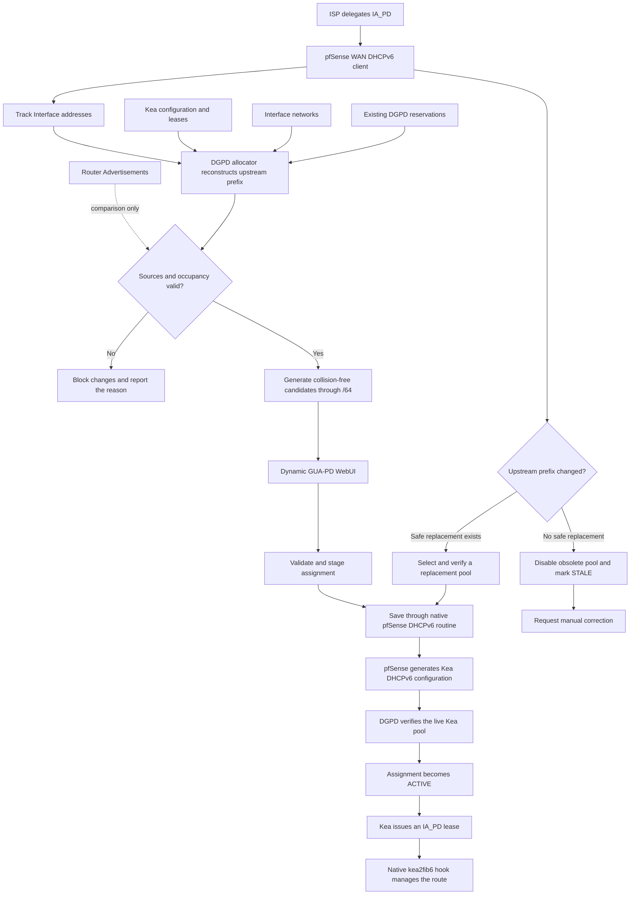

# Dynamic Global Unicast Address Prefix Delegation (DynGUA-PD)

Copyright © 2026 gebra

Contact: [projects@gbrands.de](mailto:projects@gbrands.de)

License: Apache License 2.0

DynGUA-PD manages downstream IPv6 prefix delegation on pfSense by combining
native Track Interface configuration, Kea DHCPv6, and pfSense lease routing.
It discovers the delegated upstream prefix, proposes collision-free downstream
pools, and keeps explicit ownership of the assignments it manages.

> **Project status:** Version 0.8.0 Beta RC1a for pfSense CE 2.9.0. Review the
> current limitations before using it outside a test environment.

## Introduction

I am not a software developer; I work as an IT systems and network engineer.
I had been looking for this feature for quite some time and found a few "hacky"
ways to achieve my goal. Most of the solutions I tested were unstable, unsafe,
or simply unsuitable for ordinary users who may need this functionality.

I therefore decided to spend some of my free time developing a solution that
anyone can operate through the GUI. Please feel free to test and audit it and
send me useful feedback.

## Challenges

- The required downstream prefix delegation function was not available in
  pfSense, but it was necessary for the intended network design.
- The IA_PD received on the WAN interface had to be determined reliably.
  pfSense did not expose all information required by this project through a
  single usable interface, so this was not possible without a dedicated
  allocator.
- Downstream pools must remain inside the current upstream delegation and must
  never overlap interface networks, address pools, other PD pools, leases, or
  another DGPD assignment.
- Kea stores configured PD pools statically, while an ISP can change the
  delegated upstream prefix dynamically. DGPD therefore has to detect stale
  assignments and either realign them safely or require manual intervention.
- DGPD must cooperate with pfSense instead of replacing its DHCPv6, service,
  configuration, and routing mechanisms.

## Design Goals

- Use native pfSense configuration and service routines wherever possible.
- Treat the allocator as the authoritative source for the current upstream
  prefix and free downstream pools.
- Use Router Advertisements only as secondary comparison evidence.
- Protect existing native PD configuration until the user explicitly grants
  DGPD ownership.
- Block changes when prefix sources disagree or validation is incomplete.
- Preserve unrelated Kea DHCPv6 settings and native configuration.
- Let the native `kea2fib6` hook install and remove routes for active IA_PD
  leases.
- Keep every operation recoverable and visible to the user.

## Development Standards

The project follows the native pfSense framework and adheres strictly to
Netgate's published development requirements:

- [pfSense Developer Style Guide](https://docs.netgate.com/pfsense/en/latest/references/developer-style-guide.html)
  for source layout, naming, formatting, and implementation conventions.
- [pfSense Typographic Conventions](https://docs.netgate.com/pfsense/en/latest/references/typographic-conventions.html)
  for WebUI labels, help text, notices, warnings, errors, and technical terms.

Native pfSense APIs, package controls, feedback categories, and configuration
paths are used wherever the platform provides them.

## How It Works



The allocator reconstructs the upstream delegation from active Track Interface
addresses and the WAN IA_PD length. It then excludes every known occupied
network. Its structured report supplies the WebUI with the upstream pool,
eligible interfaces, proposed assignments, and free candidates for each usable
prefix length through `/64`.

Only global unicast Router Advertisement prefixes from `2000::/3` participate
in the comparison. ULA and link-local advertisements are ignored. An RA can
confirm or contradict observed prefix information, but it cannot establish the
complete IA_PD by itself.

## WebUI

Open **Services > Dynamic GUA-PD**.

The interface selector lists only enabled Track Interface targets with active
Kea DHCPv6 and one usable live Kea subnet. Interfaces that do not qualify are
not displayed. If no target qualifies, the page explains which native settings
must be enabled.

### Information and Input Fields

| Field | Purpose |
| --- | --- |
| **Available Prefixes** | Shows the unreserved allocator proposal and expandable free candidates for every usable length through `/64`. |
| **Current Assignment** | Shows DGPD ownership, status, current pool, and a link to the native DHCPv6 page. |
| **Interface for Delegation** | Selects an eligible downstream Track Interface. Changing it clears management consent. |
| **Upstream Pool** | Displays the reconstructed upstream prefix and length. It is read-only. |
| **PD Pool Prefix** | Contains the downstream pool address without an embedded CIDR length. |
| **Pool LEN** | Selects the pool length. Kea delegates the complete selected pool to one downstream router. |
| **Downstream Impact** | Appears only when an existing delegation will change and requires acknowledgement. |
| **Allow Interface Management** | Explicitly authorizes DGPD to manage the selected interface. |
| **Usage** | Opens the native information panel describing every DGPD action. |

### Actions

| Action | Effect |
| --- | --- |
| **Propose** | Copies a free, unreserved candidate into the editor. It does not save or reserve the prefix. |
| **Apply Assignment** | Revalidates the requested pool and stages the native configuration change. |
| **Save Settings** | Runs the native pfSense DHCPv6 save routine, verifies the live Kea pool, and finalizes the DGPD state. |
| **Disable** | Removes the native PD pool while retaining the DGPD reservation. |
| **Enable** | Revalidates and restores a disabled reservation. |
| **Delete** | Removes the native pool and releases the DGPD reservation after verification. |
| **Recover** | Restores the pending native save operation after the cause of an interruption has been corrected. |
| **Acknowledge Notice** | Confirms that a persistent downstream-impact warning has been reviewed. |
| **Restore DGPD Assignment** | Replaces an external native change with the last saved DGPD assignment. |
| **Accept Native Change** | Adopts a complete, upstream-contained, aligned, and collision-free native assignment. |
| **Release Ownership** | Stops DGPD management without changing the current native DHCPv6 configuration. |

Disable and Delete can interrupt downstream connectivity. If an active IA_PD
lease exists inside the DGPD-owned pool, the WebUI requires a separate warning
confirmation. DGPD revokes only leases belonging to that pool. The native
pfSense hook then removes their routes.

## Assignment States

| State | Meaning |
| --- | --- |
| **UNMANAGED** | The interface has no DGPD-owned assignment. |
| **PENDING** | A validated operation is stored and awaits native save or verification. |
| **ACTIVE** | Saved ownership, native fields, and the live Kea pool agree. |
| **DISABLED** | The native pool is absent, but DGPD retains the reservation. |
| **STALE** | The saved pool no longer belongs to the current upstream and has been disabled. Manual correction may be required. |
| **CONFLICT** | Native configuration changed externally or another validation condition prevents a safe operation. |

An externally changed native Kea assignment is accepted automatically only when
it is complete, aligned, contained within the current upstream, collision-free,
and present in the live Kea configuration. Otherwise DGPD preserves its last
known assignment and offers controlled recovery choices.

## Native pfSense Integration

DGPD stores PD settings in the native pfSense DHCPv6 fields for the selected
interface. pfSense remains responsible for generating the Kea configuration,
starting or reloading services, and applying configuration changes.

Routes use the existing pfSense chain:

```text
Kea libdhcp_run_script -> kea_run6 -> kea2fib6.sh -> kea2fib6
```

DGPD does not implement a second route manager. Active lease additions,
updates, releases, and expiry remain under the native `kea2fib6` integration.

The optional read-only Kea page adapter can show active DGPD assignments in the
native DHCPv6 page. It remains invisible when DynGUA-PD is not installed or no
active DGPD assignment exists.

## Firewall Rules

DynGUA-PD does not create, modify, or remove firewall rules. A valid IA_PD lease
and an installed route do not permit traffic by themselves. Administrators must
review the rules on every affected interface and allow only the intended
DHCPv6, ICMPv6, and forwarded IPv6 traffic.

DynGUA-PD maintains native network aliases for use in administrator-defined
rules:

- `DGPD_<INTERFACE>_PD` contains the verified active delegated prefix for one
  managed interface.
- `DGPD_ALL_PD` contains every verified active delegated prefix managed by
  DynGUA-PD.

The aliases may contain prefixes of different lengths. DynGUA-PD changes only
their contents; it never creates or edits firewall rules. When an assignment is
disabled or becomes stale, its interface alias remains available but empty. On
deletion, an alias referenced by a rule or another alias also remains empty so
existing firewall configuration does not break.

After assigning or changing a delegated prefix, verify that the applicable
rules and aliases cover the current prefix and that no rules still reference an
obsolete prefix. This is especially important after an upstream renumber or a
manual replacement of a downstream pool.

## Prerequisites

- pfSense CE 2.9.0 or a compatible later version
- Native Kea DHCPv6 enabled and running
- A WAN DHCPv6 client receiving an IA_PD
- At least one enabled Track Interface with Kea DHCPv6
- Reachable Kea control socket
- Kea Lease Commands support for safe lease inspection and revocation
- Native `pfSense-system` `kea2fib6` integration
- `socat`, installed as a package dependency
- Router Advertisements for optional prefix comparison

Missing required prerequisites block changes and produce an actionable message.
Missing Router Advertisement data disables only the optional comparison.

## Installation

DynGUA-PD is not yet available in the official pfSense package repository.
Download the package and its SHA256 checksum from the release assets for the
signed `beta-rc1a` tag. Verify the checksum before transferring the package to
the firewall:

```sh
sha256 pfSense-pkg-dgpd-0.8.0.r2.pkg
```

Install the verified package from a pfSense shell:

```sh
pkg add -f ./pfSense-pkg-dgpd-0.8.0.r2.pkg
```

Back up the pfSense configuration before installing a pre-release build. After
installation, configure the native WAN DHCPv6 client, Track Interface, and Kea
DHCPv6 settings before opening **Services > Dynamic GUA-PD**.

See [`BUILD.md`](BUILD.md) to validate and build the package from source.

## Current Limitations

- Version 0.8.0 Beta RC1a is pre-release software and continues public beta
  qualification.
- Complete automatic handling of every ISP renumber, WAN failure, reboot, and
  service-reload sequence is still being validated.
- Router Advertisements are comparison evidence and are not an independent
  authoritative IA_PD source.
- Historical Kea leases are treated conservatively and can prevent immediate
  prefix reuse.
- A downstream router may require DHCPv6-PD renewal or manual reconfiguration
  after its delegated prefix changes.
- Native configuration changes outside DGPD can require Restore, Accept Native
  Change, or Release Ownership.

## Translations

English (`en-US`) is the source language. A complete German (`de-DE`)
translation catalog is maintained with the project. DynGUA-PD uses the native
pfSense gettext domain and does not install a private translation framework or
replace the system-wide pfSense catalog.

## Credits

- [The pfSense Team](https://github.com/pfsense) — Native pfSense platform,
  package framework, DHCPv6 configuration, and Kea integration.
- [R. Christian McDonald](https://github.com/theonemcdonald) — pfSense Kea
  integration, DHCPv6-PD support, and native `kea2fib6` route handling.
- Aleksey Pevnev — Maintenance of the FreeBSD `net/kea` port used by pfSense.
- [ISC Kea](https://www.isc.org/kea/) — DHCP server and control API.

## License

DynGUA-PD is licensed under the Apache License, Version 2.0. See the complete
license text in the [`LICENSE`](LICENSE) file.
